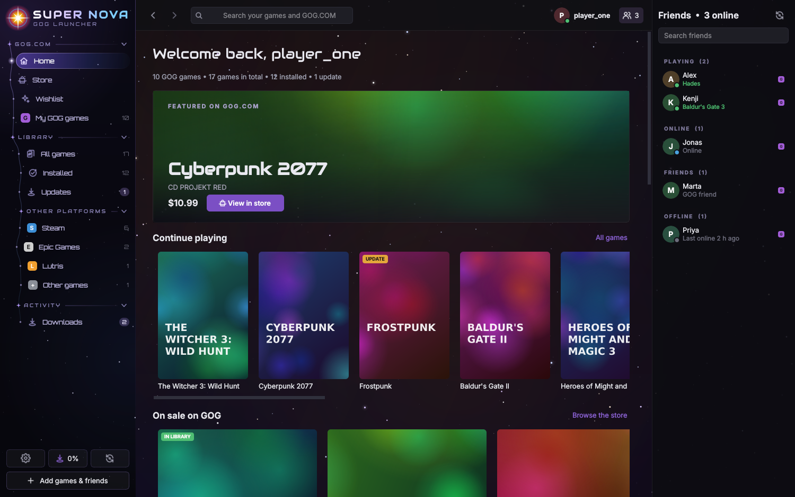
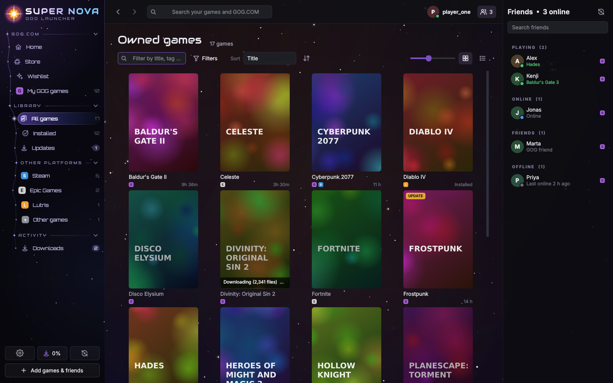
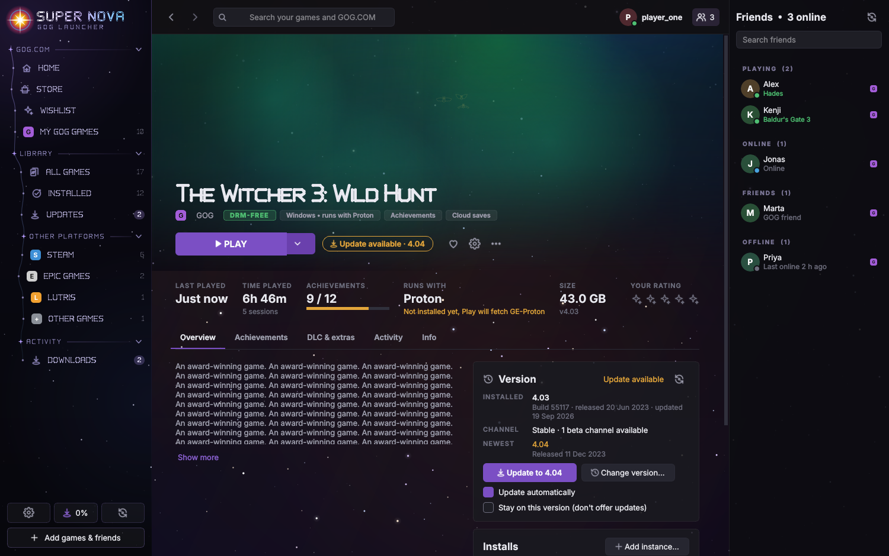
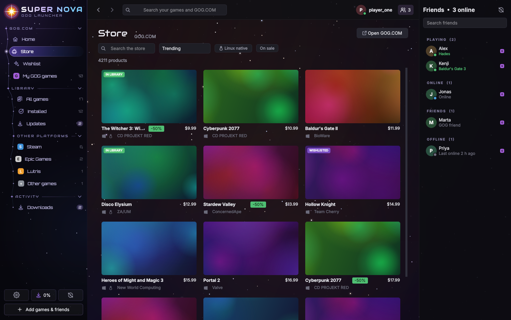
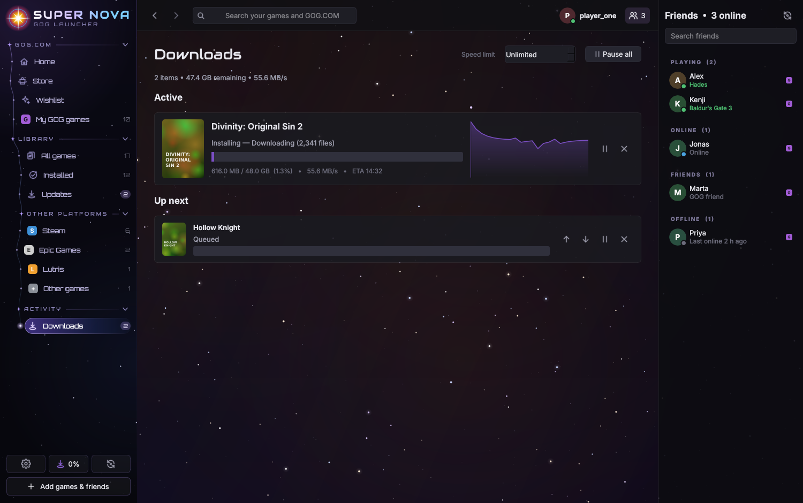
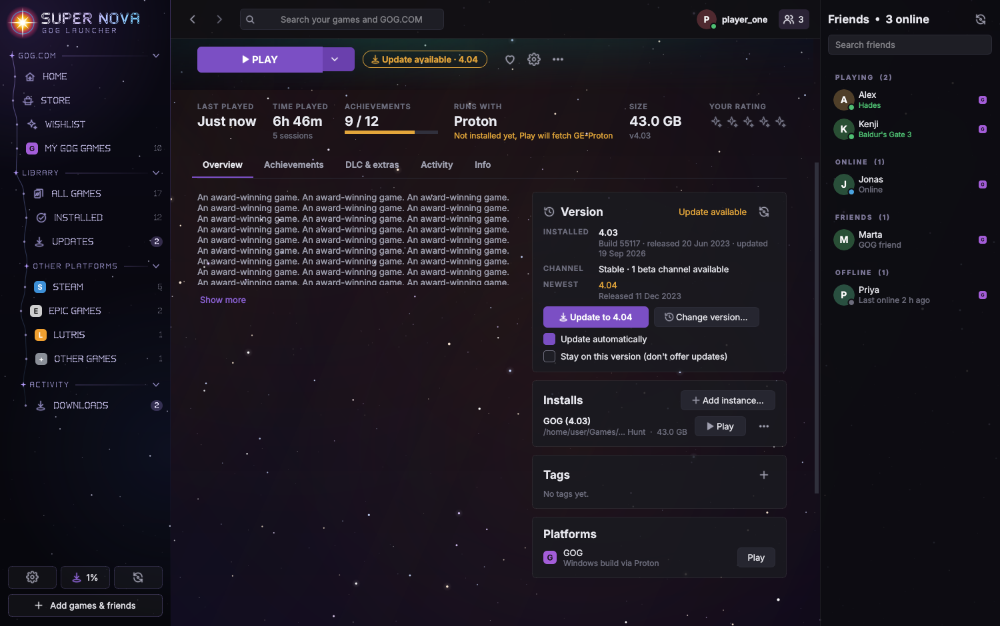
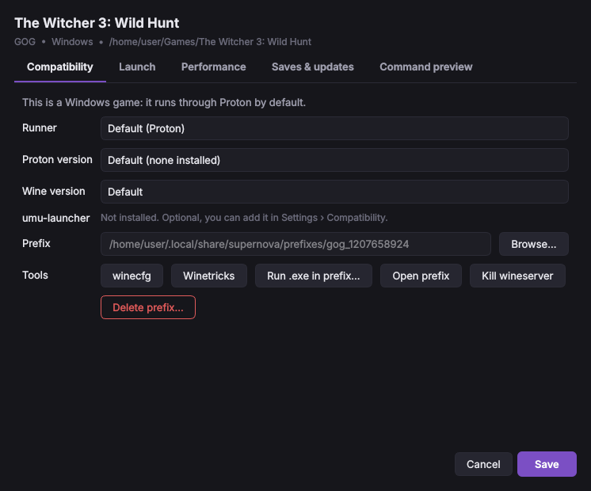

# Super Nova

A GOG Galaxy–style game launcher for Linux.

First off, yes this was vibe coded and no this is not associated with the old nebula project from years ago. This is something
I was going to keep private, but am forced to make public in order for certain features to work. This is the closest we will probably
get to a dedicated GOG launcher for the near foreseeable future. If you are interested in this project and want to use this as a starting
place for a future project feel free to fork it.

(It used to be called Nebula. If you had that installed, it moves your stuff over on its own and the `nebula`
command still works. The old look is still there as the "Nebula" theme.)



## Installing

You need Python 3.10 or newer.

```bash
git clone https://github.com/BounciestSky152/Super-Nova-Launcher.git
cd Super-Nova-Launcher
./scripts/install.sh
```

That sets up a virtual environment, a `supernova` command and a menu entry. Use `./scripts/install.sh --webengine`
if you want the GOG login page inside the app instead of in your browser, and `--uninstall` to remove it again
(your library and saves are left alone).

Or just run it from the folder: `pip install -r requirements.txt` then `python -m nebula`.

Optional stuff it'll use if you have it: `umu-launcher`, `gamemode`, `mangohud`, `gamescope`, `innoextract`,
`winetricks`, `legendary` (for Epic), `dosbox-staging`, `scummvm`.

## What it does

It's GOG first. Sign in and you get your GOG library, the store, your wishlist, cloud saves, achievements and
friends, roughly the way Galaxy lays them out. Steam, Epic (through Legendary/Heroic), Lutris and games you add by
hand show up in the same library.

- Windows games run through Proton automatically. It finds the Proton versions you already have, prefers
  GE-Proton, and can download GE-Proton for you. Every game gets its own prefix, and there's a per-game settings
  dialog for the usual knobs (Proton version, gamemode, MangoHud, gamescope, env vars, launch options...).
- Native Linux builds are preferred when GOG has one.
- Downloads can be paused, resumed, reordered and speed-limited, and an interrupted install picks up where it
  stopped.
- Updates only download what changed. For Linux games it reads the installer straight off GOG's server and only
  grabs the files that are different, so you're not pulling down the whole game again.
- You can roll back to older versions or switch to beta channels (Windows builds only, because that's all GOG
  publishes old versions for). Rolling back pins the game so it stops nagging you about updates.
- You can keep more than one copy of a game on different versions ("instances"), e.g. an old version for mods and
  the latest for everything else. Each one has its own folder and prefix.
- Play always plays. If there's an update you get a small notice next to the button instead of it forcing an
  update on you.
- DLC can be installed or removed whenever.
- Cloud saves, achievements, play time tracking (including games started outside the launcher), a friends list.
- There's a handheld mode for the Steam Deck and similar: fullscreen, controller navigation, bigger everything.
  Toggle it with F12.
- Two themes: the dark Nebula one and a bright one called Super Nova. Classic is the very first look.
- It updates itself from this repo. It only updates when the actual app code changes (README edits and such don't
  count), waits until you're not playing anything, and never restarts on its own.

| | |
|---|---|
|  |  |
|  |  |
|  |  |

## Hooking up other platforms

- **GOG:** sign in from the welcome screen or the top bar. Without the webengine extra it opens your browser and
  you paste the address you end up on back into the app.
- **Steam:** installed games are picked up from your Steam folder. Add a
  [Steam Web API key](https://steamcommunity.com/dev/apikey) in Settings › Integrations if you want games you
  haven't installed, achievements and friends too.
- **Epic:** log in once with `legendary auth` (or in Heroic). Games launch through Legendary using Super Nova's
  Proton settings.
- **Lutris:** detected automatically.
- **Anything else:** Add games › Add game manually.

## Command line

```
supernova                          start (or bring the open window to the front)
supernova --launch gog:1207658924  launch a game, used by desktop shortcuts
supernova --minimized              start in the tray
supernova --debug                  verbose logs in ~/.local/share/supernova/logs
supernova --no-update              skip the update check this time
```

## Where it keeps things

- `~/.config/supernova/`: settings and your GOG login
- `~/.local/share/supernova/`: library database, Proton prefixes, downloaded Proton, logs
- `~/.cache/supernova/`: cover art and half-finished downloads
- `~/Games/SuperNova/`: where games go by default (change it in Settings)

## Plugins

Drop a `.py` file in `~/.local/share/supernova/plugins/` with a subclass of `nebula.integrations.base.Integration`
and it becomes a new platform. See [`docs/examples/example_plugin.py`](docs/examples/example_plugin.py).

## Known issues

- I haven't been able to test against every game, so some things will break. If something does, run
  `supernova --debug` and open an issue with the log.
- If a game closes right after you hit Play, the app tells you the exit code and where the log is. For old native
  Linux ports that's often a missing 32-bit library on your system.
- Password-protected GOG betas aren't supported, only public ones.
- GOG doesn't publish cloud save locations for Linux builds, so cloud saves only work for Windows builds.
- GOG's friends API doesn't give online status, so friends are listed without it.
- No in-game overlay (MangoHud is the closest thing) and no chat (GOG has no public API for it).

## Hacking on it

```bash
pip install -e .[dev]
QT_QPA_PLATFORM=offscreen pytest
```

The tests spin up fake GOG/GitHub servers locally, so they don't need an account or internet.

## Credits and legal bits

Not affiliated with GOG, Valve, Epic or Lutris. It uses the same public GOG Galaxy client ID the other open-source
GOG launchers use.

A lot of the GOG protocol knowledge comes from [heroic-gogdl](https://github.com/Heroic-Games-Launcher/heroic-gogdl),
[minigalaxy](https://github.com/sharkwouter/minigalaxy) and the community
[GOG API docs](https://gogapidocs.readthedocs.io/). Proton bits lean on
[umu-launcher](https://github.com/Open-Wine-Components/umu-launcher) and
[GE-Proton](https://github.com/GloriousEggroll/proton-ge-custom).

Fonts are [Audiowide](https://fonts.google.com/specimen/Audiowide) and
[Orbitron](https://fonts.google.com/specimen/Orbitron) (SIL Open Font License, licences in `nebula/assets/fonts/`).
