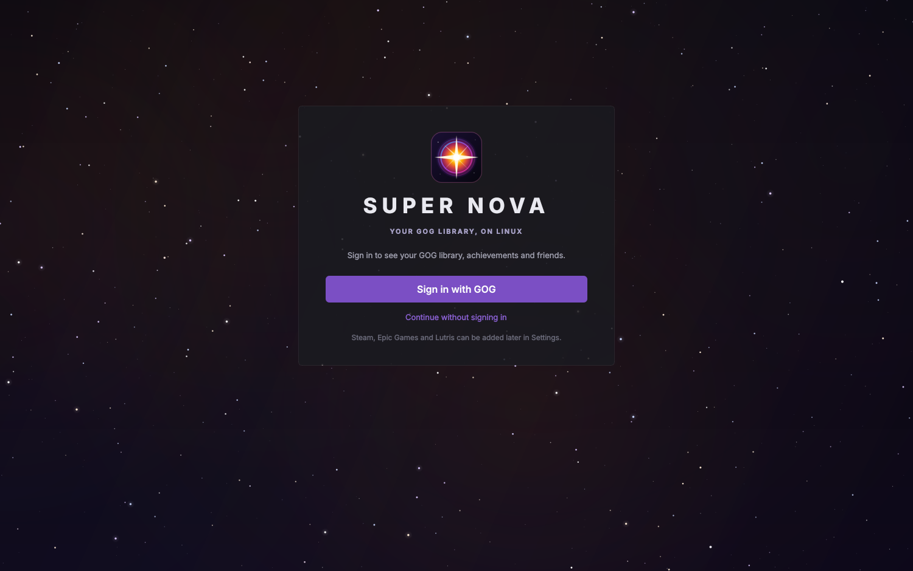
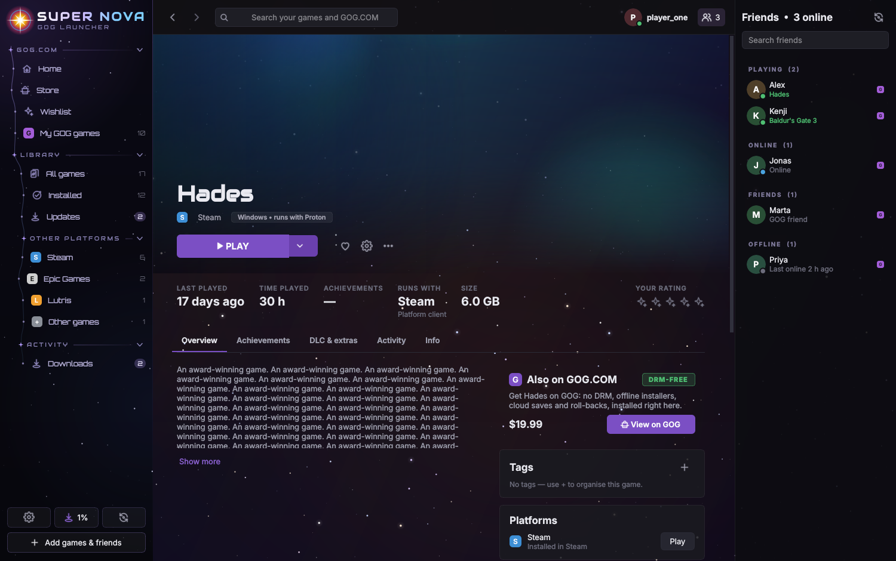
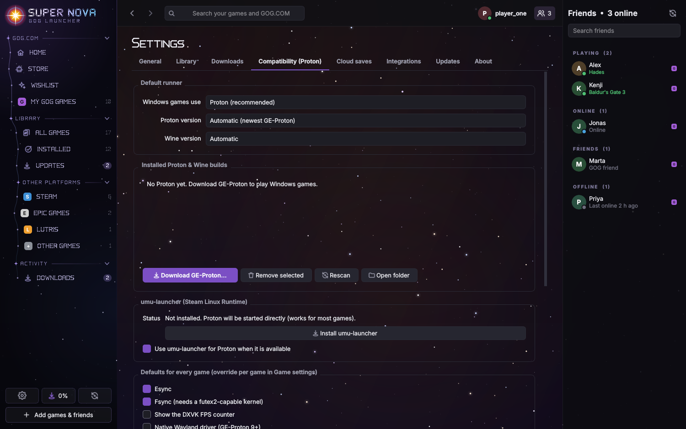
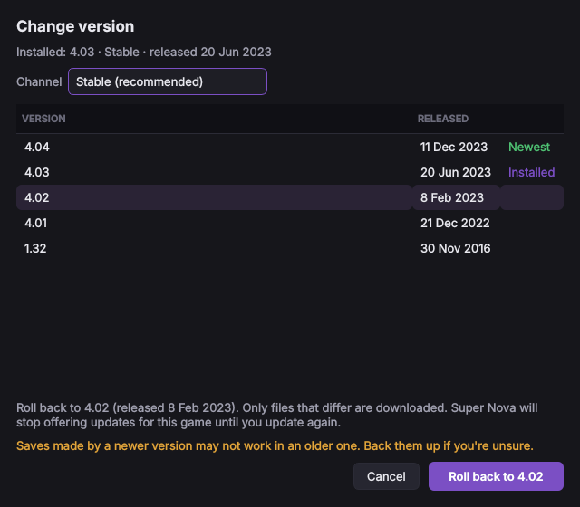
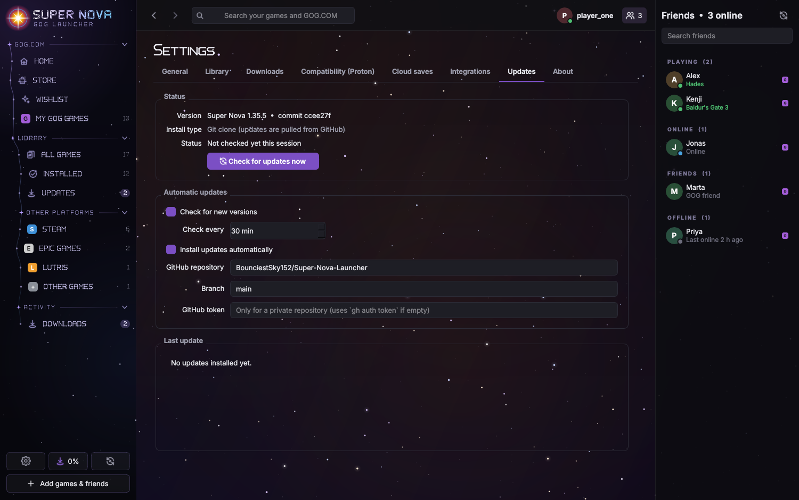

# Super Nova — a GOG Galaxy-style launcher for Linux

*Super Nova was called Nebula before version 1.3.12. Installs from before the rename move their settings, library and command over by themselves (`nebula` still works as a command), and the original look lives on as the **Nebula** theme next to the new light **Super Nova** theme.*

First off, yes this was vibe coded and no this is not associated with the old nebula project from years ago. This is something
I was going to keep private, but am forced to make public in order for certain features to work. This is the closest we will probably
get to a dedicated GOG launcher for the near foreseeable future. If you are interested in this project and want to use this as a starting
place for a future project feel free to fork it.


# Installation

/scripts/install.sh


# And of course the rest

Super Nova is a GOG launcher first. Sign in with GOG and your GOG library, the GOG store, your wishlist, cloud saves,
achievements and GOG friends sit at the centre of the app, the way they do in GOG Galaxy 2.0. Your **Steam**,
**Epic Games** (through Legendary/Heroic), **Lutris** and hand-added games join the same library alongside them.
**Every Windows-only game runs through Proton automatically.** Super Nova also **updates itself from GitHub**.


| | |
|---|---|
|  |  |
|  |  |
|  |  |
|  |  |

## Built around GOG

* **Sign in with GOG first.** The first time Super Nova starts it shows a GOG sign-in screen. You can skip it and
  sign in later from the top bar.
* **The sidebar starts with GOG.COM:** Home, Store, Wishlist and *My GOG games*. After that come your whole
  library (all games, installed, favourites, updates), then other platforms, your saved views and activity.
* **The top bar works like Galaxy's.** It has back/forward, one search box for your games and the GOG store,
  sync, downloads and friends. Your GOG avatar opens your profile, wishlist and account settings, and lets you
  sign out.
* **Home is GOG-centred.** It shows a featured GOG deal, *Continue playing*, *On sale on GOG*, *From your
  wishlist*, updates, your GOG games, recent additions, your week, friends playing now and recent activity.
* **Game pages show what GOG gives you:** a **DRM-FREE** badge plus Linux-native/Proton, achievements, cloud
  saves and DLC chips. For games you only own on Steam, Epic or elsewhere, an **Also on GOG.COM** card shows the
  DRM-free version with its current price.
* **Version card on GOG game pages.** It shows the installed version, the build and when it was released and
  installed, the channel (Stable or a beta), and the newest version GOG offers. From the card you can update to
  the newest version, open *Change version…* to roll back or move to any other build, or switch to a beta
  channel. Two switches control updates: *Update automatically*, and *Stay on this version*, which stops update
  offers for that game. The Info tab lists the same details. See [Game versions](#game-versions) below.
* **A starfield sits behind the whole window.** Glass panels let the night sky show through. A few stars twinkle
  and the odd shooting star crosses the sky, but only those few pixels are redrawn, and the animation stops
  while a game is running or the window is minimised. You can turn the stars, or just their animation, off in
  Settings › General › Appearance.

## Game versions

Every GOG game has a **Version** card on its page and matching rows in the Info tab. For a game you haven't installed yet, the card shows the newest version GOG offers and an *Install* button.


* **The card shows:**
  * *Installed*: the version, the GOG build number, when that build was released and when you last updated.
  * *Channel*: Stable, or the beta you're on. It also tells you how many beta channels are available.
  * *Newest*: the newest version on your channel, with a status: *Up to date*, *Update available*,
    *Staying on …* or *Channel ended*.
* **Update to <version>** downloads only what changed. You can also press the orange **UPDATE** button at the top
  of the page; *Play without updating* is in its dropdown.
* **Change version…** lists every build GOG publishes for the game, newest first, grouped by channel.
  * Pick an older build to **roll back**. Only the files that differ are downloaded.
  * Pick a build from another channel to **switch to a beta**. *Stable (recommended)* takes you back.
  * The dialog warns you before a rollback or channel switch that could affect saves.
  * DLC that an older build doesn't include is removed, and it comes back when you update again.
* **Pinning:** rolling back, or choosing a version that isn't the newest, turns on **Stay on this version**.
  Super Nova then stops offering updates for that game, but still shows what the newest version is. Updating to the
  newest version, or switching to the newest build of another channel, turns the pin off again. You can also
  tick or untick it yourself.
* **Update automatically** is a per-game switch. It follows the global setting in Settings › Downloads.
* **If a beta channel ends**, Super Nova never moves you back automatically, because Stable can be older than your
  beta. The card offers *Switch to Stable* instead.
* **Linux native versions** come from GOG's offline installers. GOG only offers the newest installer, so these
  can be updated to the newest version but not rolled back. Older versions and beta channels are only available
  for the Windows version (GOG Galaxy builds), which Super Nova runs with Proton.
* **Version checks** happen when you open a game page (at most every few minutes) and during the regular update
  check. A failed check never hides an update Super Nova already found. The card shows when GOG was last checked
  and has a button to check again.
* **Updates only download what changed.** Galaxy builds reuse every unchanged chunk already on disk. Native Linux
  games are read straight from GOG's installer on the server: only the compressed data of new or changed files is
  downloaded, files the new version dropped are removed, and the installer itself is never stored.
* **Instances: several versions side by side.** When you update or change the version of an installed game, Super
  Nova asks whether to *update this install* or *add a new instance*. A new instance installs that version in its own
  folder next to your copy (with its own Proton prefix), so you can keep, say, 1.0 for mods and the newest version
  for everything else. The game page's **Installs** card lists every instance with Play and a menu to update,
  change version, make it the default, open its folder or uninstall it; *Add instance…* installs another one.



## Proton: Windows games just work

* **Proton is the default** for every game without a native Linux build: GOG Windows builds, Epic games,
  Windows `.exe` files you add by hand, and GOG's Windows offline installers.
* Super Nova finds Proton automatically in `~/.steam/.../compatibilitytools.d`, Steam's `steamapps/common/Proton*`,
  system packages and its own runner folder. It prefers the newest **GE-Proton**.
* **One-click GE-Proton download** (Settings › Compatibility, or *Add games › Download GE-Proton*). Downloads are
  checked against their SHA-512 sums before they are unpacked.
* **umu-launcher support.** When `umu-run` is installed (or installed from Settings with one click), Proton runs
  inside the Steam Linux Runtime the way Steam runs it. It also applies per-game **protonfixes**, looked up in the
  umu database by store and game ID. Without umu, Super Nova runs `proton waitforexitandrun` itself and supplies the
  environment Steam would provide.
* **One prefix per game**, plus per-game Proton or Wine version, winecfg, winetricks, *Run .exe in prefix*,
  kill wineserver and delete prefix.
* **Tweaks, global or per game:** Feral GameMode, MangoHud, gamescope (with arguments), DXVK HUD, FPS limit,
  esync/fsync, native Wayland, NVAPI/DLSS, environment variables, wrapper commands, extra arguments and
  executable overrides. A *Command preview* tab shows the exact command and environment that will run.
* GOG games that need MSVC, DirectX or .NET get **GOG's redistributables** installed into the prefix on first
  launch, as Galaxy does on Windows.
* GOG's DOS and ScummVM games run on **native DOSBox and ScummVM** when they are installed.


## GOG Galaxy 2.0 features

| Galaxy feature | Super Nova |
|---|---|
| Unified library across platforms | ✅ GOG, Steam, Epic (Legendary/Heroic), Lutris, manual games, plugins |
| Same game owned on several platforms merged into one entry | ✅ pick the preferred platform per game |
| Grid and list views, cover size, sorting | ✅ |
| Filters: platform, installed, OS, genre, tags, played, favourites, updates, hidden | ✅ with removable filter chips |
| Custom views saved in the sidebar | ✅ *Filters › Save as view* |
| Tags, star rating, favourites, hide game, rename, custom covers | ✅ |
| Home: continue playing, GOG deals, wishlist, updates, recently added, your week, friends, activity | ✅ |
| Game page: hero art, description, screenshots, trailers, info, links, changelog | ✅ |
| Install GOG games | ✅ Galaxy content system (generation 2) for Windows builds, native `.sh` installers for Linux builds |
| Choose language, DLC, version and location at install time | ✅ |
| Download queue: pause, resume, cancel, reorder, speed limit, parallel connections | ✅ interrupted installs resume where they stopped |
| Automatic updates and update notifications | ✅ per-game opt-out |
| Installed and newest version on the game page | ✅ version, build, release date, channel, last update |
| Roll back to an older version / change version | ✅ any published build; rolling back pins the version |
| Beta channels | ✅ public betas; switch back to Stable at any time |
| Verify / repair game files | ✅ chunk-level MD5 verification; only broken files are re-downloaded |
| Delta updates | ✅ unchanged chunks of changed files are reused from disk |
| Install DLC later, uninstall | ✅ |
| Cloud saves | ✅ GOG cloud storage, synced on launch and exit, with conflict handling. Save paths are resolved inside the Proton prefix. |
| Achievements with rarity | ✅ GOG; Steam with a Web API key. Unlock notifications after each session. |
| Play-time tracking, including games started outside the launcher | ✅ process detection, including Wine/Proton processes and Steam's reaper |
| Play time reported to your GOG profile | ✅ |
| Statistics: hours per week and day, most played, platforms, genres | ✅ |
| Friends list, "now playing" | ✅ GOG friends; Steam friends with status and current game; notifications |
| Online presence shown to GOG friends | ✅ |
| GOG store: browse, search, sort, Linux-only and on-sale filters, product pages | ✅ purchases open gog.com |
| Wishlist | ✅ view, add, remove |
| Scan and import folders | ✅ GOG game folders, plus games installed by Heroic |
| Add a game manually | ✅ Linux binaries, Windows `.exe` (Proton), emulator command lines |
| Extra launch options (editor, settings, manuals) | ✅ from GOG's `playTasks` |
| Install / uninstall / verify Steam and Epic games | ✅ handed to Steam, or run through Legendary with progress shown in Downloads |
| Desktop and menu shortcuts, tray icon, notifications, start minimised | ✅ `supernova --launch gog:<id>` |
| Integrations / plugins | ✅ Python plugin API modelled on Galaxy's integration API |
| In-game overlay | ⚠️ Galaxy's overlay hooks DirectX on Windows, which isn't possible here. MangoHud is offered instead. |
| Chat | ❌ GOG has no public chat API |
| PlayStation, Xbox, Battle.net, Ubisoft, EA | ⚠️ through Lutris (installed games) or a plugin |

## Automatic updates from GitHub

Super Nova checks [BounciestSky152/Super-Nova-Launcher](https://github.com/BounciestSky152/Super-Nova-Launcher) for new
commits every 30 minutes (and 20 seconds after start-up). It only updates when **files the app actually runs**
have changed:

* **Runtime files** are everything in the `nebula/` package, plus `pyproject.toml` because it lists the
  dependencies.
* **Ignored files** include `README.md`, `docs/` and screenshots, `tests/`, `scripts/`, CI settings and
  `__pycache__`. A commit that only touches these never triggers an update, a download or a restart.

Super Nova decides this by comparing the git blob hashes of your installed files with the tree of the latest commit
on GitHub. It doesn't need to know which version you started from, and it only reports a file that really
differs.

How an update is installed depends on how you installed Super Nova:

| Install type | What the updater does |
|---|---|
| Git checkout (`git clone` + `python -m nebula`) | `git fetch` + fast-forward merge. It refuses to touch a checkout with local edits or diverged history. |
| `scripts/install.sh` / pip in a virtual environment | Downloads the commit's source tarball, checks **every runtime file against GitHub's hashes**, then runs `pip install --upgrade` (`--no-deps` unless `pyproject.toml` changed). |
| Plain copy of the source | Replaces changed files, adds new ones and removes deleted ones, all verified the same way. |
| Read-only (system package) | Tells you an update exists and links to GitHub. |

Safety:

* Every Super Nova module is loaded at start-up, so swapping files on disk can't leave a half-updated program
  running.
* An update that arrives while a game is running or a download is active waits until they finish.
* After installing, a banner offers *Restart now*. Super Nova never restarts on its own; the new version starts the
  next time you restart it.
* A note after the restart lists the commits that were applied.

Settings › Updates shows the version and commit, the install type and status, and a *Check for updates now*
button. It also has switches for automatic checking and installing, plus the check interval and the
repository/branch to follow. Start with `supernova --no-update` (or set `SUPERNOVA_NO_UPDATE=1`) to turn the updater
off for one session.

**Private repository:** GitHub answers *404* to anonymous requests, so add a token in Settings › Updates. Without one, Super Nova uses `$GITHUB_TOKEN` or the GitHub CLI login (`gh auth login`).

The updater only contacts GitHub. Checking for a new commit uses a conditional request that doesn't count
against GitHub's API rate limit, and if the limit is reached anyway it falls back to the git protocol. The file
list and the tarball are fetched only when there really is a new commit.



## Install

You need Python 3.10 or newer. Then:

```bash
./scripts/install.sh               # per-user install: venv, `supernova` command, menu entry
./scripts/install.sh --webengine   # same, plus the embedded GOG login page
./scripts/install.sh --uninstall
```

To run it from the source tree instead:

```bash
pip install -r requirements.txt
python -m nebula
```

Recommended system packages (all optional): `umu-launcher`, `gamemode`, `mangohud`, `gamescope`, `innoextract`
(unpacks GOG Windows offline installers without Wine), `winetricks`, `legendary` (Epic), `dosbox-staging`,
`scummvm`. Settings › Compatibility › *Detected tools* shows which ones Super Nova found.

## Connecting platforms

* **GOG:** use the welcome screen, or *Sign in with GOG* in the top bar. With PySide6-Addons the login page opens inside Super Nova.
  Without it, Super Nova opens your browser and you paste the final `on_login_success` address back.
* **Steam:** installed games, play time and artwork are read from your local Steam folder. For games you own but
  haven't installed, plus achievements and friends, add a
  [Steam Web API key](https://steamcommunity.com/dev/apikey) in Settings › Integrations.
* **Epic Games:** sign in once with `legendary auth` or in Heroic. Super Nova reads the library and launches games with
  `legendary launch --no-wine --wrapper <Proton>`, so they run with Super Nova's Proton settings.
* **Lutris:** detected automatically. Games launch through Lutris.
* **Other games:** use *Add games › Add game manually*.

## Command line

```
supernova                       start, or bring the running window to front
supernova --launch gog:1207658924   launch a game (used by desktop shortcuts)
supernova --minimized           start in the tray
supernova --debug               verbose logging (~/.local/share/supernova/logs)
supernova --no-update           don't check GitHub for Super Nova updates this session
```

Keyboard shortcuts:

| Keys | Action |
|---|---|
| Ctrl+F | Search |
| Alt+← / Alt+→ | Back / forward |
| F5 or Ctrl+R | Sync all platforms |
| Ctrl+1 … Ctrl+5 | Home, All games, Installed, Store, Downloads |
| Ctrl+, | Settings |

## Plugins

Drop a `.py` file into `~/.local/share/supernova/plugins/` and restart Super Nova. Any subclass of
`nebula.integrations.base.Integration` in that file becomes a new platform. It can implement any subset of
`fetch_library`, `prepare_launch`, `install`, `achievements`, `friends` and the other methods in
[`nebula/integrations/base.py`](nebula/integrations/base.py).
[`docs/examples/example_plugin.py`](docs/examples/example_plugin.py) is a complete ROM-library example.

## Where things live

| Path | Contents |
|---|---|
| `~/.config/supernova/` | settings, GOG credentials (mode 600) |
| `~/.local/share/supernova/` | library database, Proton prefixes, downloaded Proton/umu, GOG manifests, redistributables, logs, `update-state.json` |
| `~/.cache/supernova/` | artwork cache, partially downloaded installers |
| `~/Games/SuperNova/` | default install folder (change it in Settings › Library) |

## Development

```bash
pip install -e .[dev]
QT_QPA_PLATFORM=offscreen pytest
```

The tests start local HTTP servers that act as GOG's CDN and cloud storage. They run a full GOG install through
these fake servers:

* chunked parallel download, launch-command generation through Proton, delta update, rollback, verify/repair
  and uninstall;
* cloud-save upload, download and conflict handling;
* Proton/umu command lines;
* GE-Proton download and checksum verification;
* the Steam, Epic, Lutris and Linux-installer importers, process detection and the job queue;
* the self-updater, against a fake GitHub API/codeload and a local git remote. It covers docs-only commits
  being ignored, runtime changes being applied, tampered downloads being rejected, the git fallback when the
  API is rate-limited, pip/git/file install modes, and local edits blocking an update;
* a smoke test that opens every page and dialog, plus checks of the GOG welcome flow, the DRM-free offer, the
  update banner, and that a restart never happens while a game is running.

Code layout:

```
nebula/
  updater.py     self-updater: GitHub tree comparison, verified download, git/pip/file installs
  core/          settings, SQLite storage, library merging, job queue, launcher and session tracking, images,
                 self_update (schedules checks, waits for games, restarts)
  runners/       Proton/Wine detection and command building, GE-Proton and umu downloads
  integrations/  gog/ (auth, API, Galaxy content system, offline installers, cloud saves), steam, epic, lutris, local
  ui/            PySide6 interface: shell, pages, dialogs, widgets, theme
```

## Status and limitations

* GOG's servers could not be reached from the environment Super Nova was built in. The GOG protocols (OAuth, Galaxy
  content system, secure links, cloud storage, gameplay, presence) follow the open-source implementations in
  Heroic's *gogdl* and *minigalaxy*, and they are exercised against simulated servers in the test suite. Your
  first real sign-in and install is the first live run. If something fails, run `supernova --debug` and check the
  logs.
* Password-protected GOG beta channels aren't supported yet; public beta channels are.
* GOG cloud saves work for Windows builds, which keep their saves inside the Proton prefix. GOG doesn't publish
  cloud-save locations for its Linux builds.
* The GOG friends list comes from an undocumented endpoint. Friends' online status isn't available, so they're
  listed without presence.
* Super Nova signs in with the public GOG Galaxy client ID that all open-source GOG launchers use. It is not
  affiliated with GOG sp. z o.o., Valve, Epic Games or Lutris. Store pages and artwork belong to their owners.

## Credits

The bundled fonts are [Audiowide](https://fonts.google.com/specimen/Audiowide) and [Orbitron](https://fonts.google.com/specimen/Orbitron), both under the SIL Open Font License (licence texts in `nebula/assets/fonts/`). Settings › General › Appearance lets you swap them, or the interface font, for any installed font.

Protocol knowledge comes from [heroic-gogdl](https://github.com/Heroic-Games-Launcher/heroic-gogdl),
[minigalaxy](https://github.com/sharkwouter/minigalaxy), the community
[GOG API documentation](https://gogapidocs.readthedocs.io/),
[umu-launcher](https://github.com/Open-Wine-Components/umu-launcher) and
[GE-Proton](https://github.com/GloriousEggroll/proton-ge-custom).
